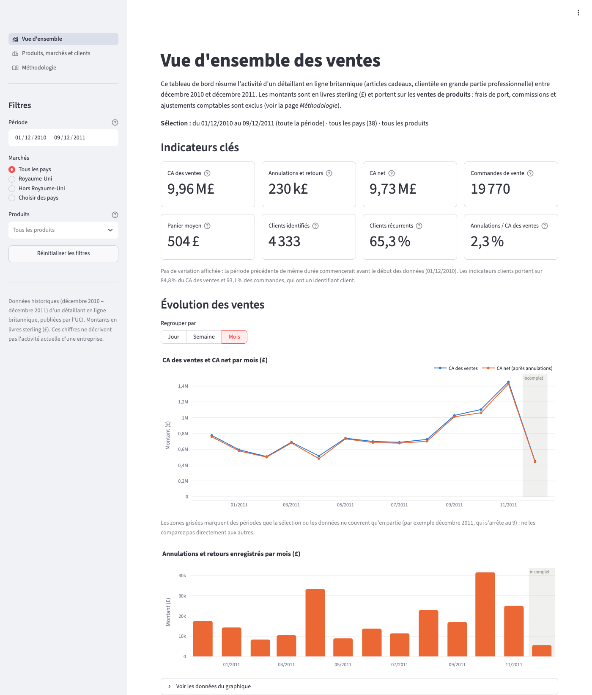
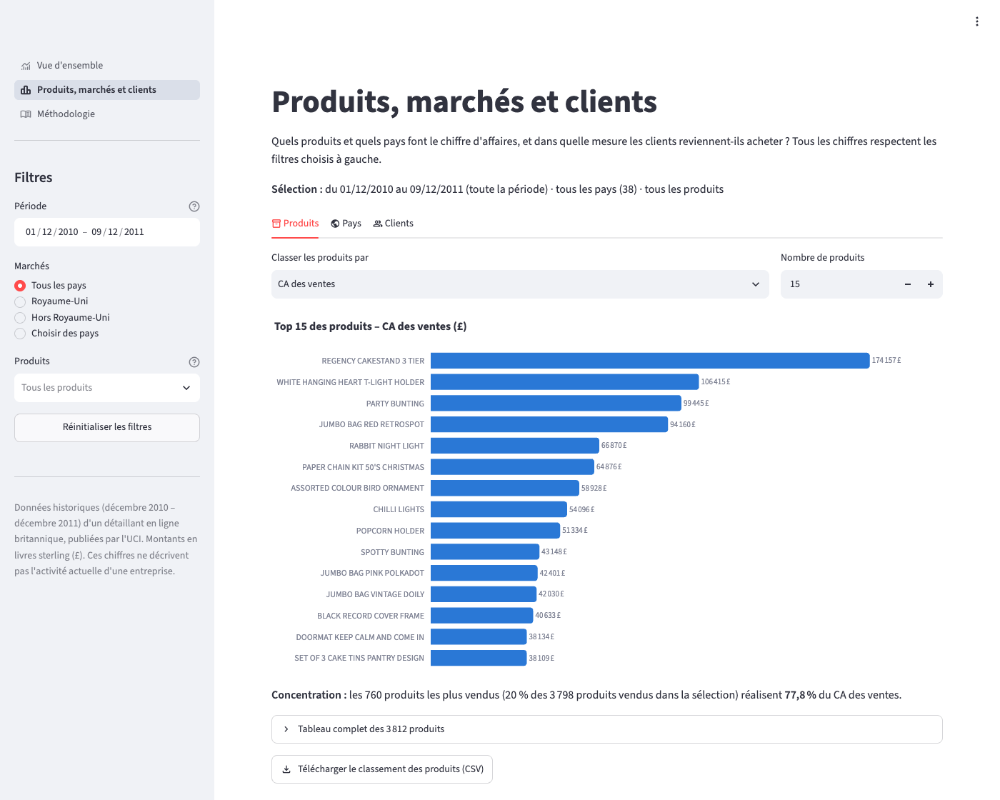
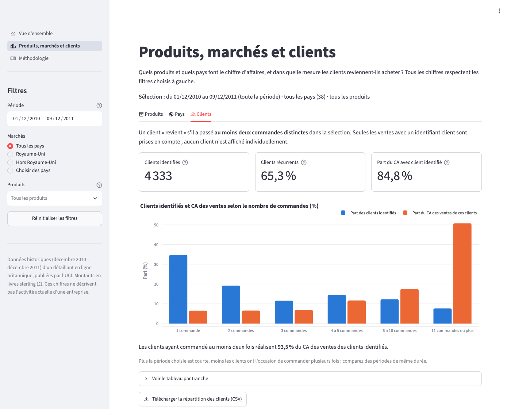
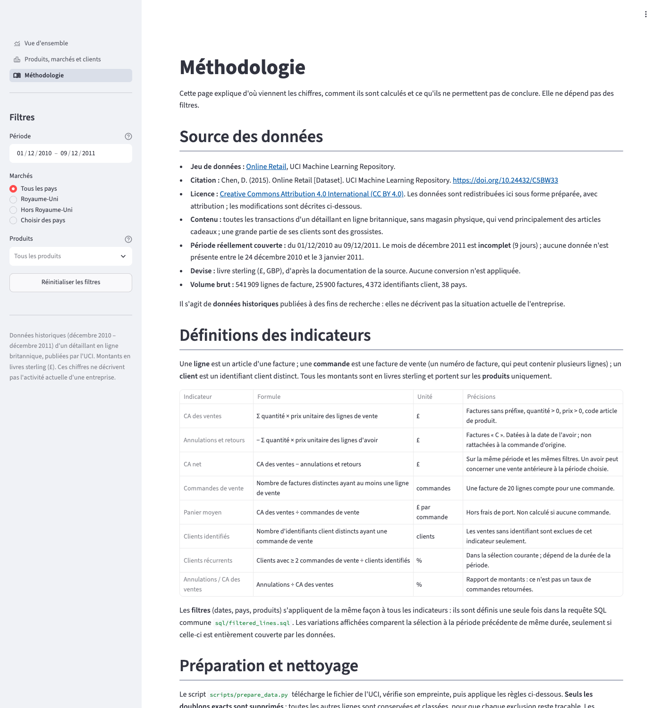

# Tableau de bord des ventes e-commerce – Online Retail (UCI)

Application Streamlit qui aide un responsable commercial à comprendre **l'évolution des ventes**,
**les produits et marchés qui font le chiffre d'affaires**, **la fidélité des clients** et **le poids
des annulations et retours**, à partir des transactions réelles d'un détaillant en ligne britannique
(décembre 2010 – décembre 2011).

**Application en ligne :** _lien à ajouter après le déploiement sur Streamlit Community Cloud_



## Le problème métier

Un fichier de 541 909 lignes de facture ne répond à aucune question tel quel. Ce projet transforme
ces lignes en indicateurs fiables, définis précisément et vérifiés :

- Comment évoluent les ventes, mois par mois, semaine par semaine ou jour par jour ?
- Quels produits et quels pays contribuent au chiffre d'affaires ?
- Les clients reviennent-ils acheter ?
- Quelle part représentent les annulations et retours ?

Les filtres (dates, pays, produits) s'appliquent de façon identique à tous les indicateurs, et chaque
résultat peut être exporté en CSV.

## Captures

| Produits | Clients | Méthodologie |
|---|---|---|
|  |  |  |

## Les données

- **Source :** [Online Retail](https://archive.ics.uci.edu/dataset/352/online+retail), UCI Machine
  Learning Repository.
- **Citation :** Chen, D. (2015). *Online Retail* [Dataset]. UCI Machine Learning Repository.
  https://doi.org/10.24432/C5BW33
- **Licence :** [Creative Commons Attribution 4.0 International (CC BY 4.0)](https://creativecommons.org/licenses/by/4.0/).
  Le fichier préparé `data/processed/online_retail_lines.parquet` est une version transformée de ces
  données (doublons exacts retirés, colonnes ajoutées, lignes classées) ; les transformations sont
  décrites dans [`reports/data_quality.md`](reports/data_quality.md).
- **Période réelle :** du 01/12/2010 au 09/12/2011. **Décembre 2011 est incomplet** (9 jours).
- **Devise :** livre sterling (£), d'après la documentation de la source.

Ce sont des **données historiques** publiées pour la recherche : elles ne décrivent pas la situation
actuelle de l'entreprise.

## Définitions des indicateurs

Une **ligne** est un article d'une facture ; une **commande** est une facture de vente (elle peut
contenir plusieurs lignes) ; un **client** est un identifiant client distinct. Les indicateurs portent
sur les **ventes de produits** : frais de port, commissions Amazon, frais bancaires, remises et
ajustements comptables sont exclus et chiffrés à part.

| Indicateur | Définition | Unité |
|---|---|---|
| CA des ventes | Σ quantité × prix unitaire des lignes de vente de produits | £ |
| Annulations et retours | − Σ quantité × prix des lignes d'avoir (factures « C »), à la date de l'avoir | £ |
| CA net | CA des ventes − annulations et retours de la même période | £ |
| Commandes de vente | Factures distinctes ayant au moins une ligne de vente | commandes |
| Panier moyen | CA des ventes ÷ commandes de vente | £ / commande |
| Clients identifiés | Identifiants client distincts ayant au moins une commande de vente | clients |
| Clients récurrents | Clients identifiés avec ≥ 2 commandes ÷ clients identifiés | % |
| Annulations / CA des ventes | Rapport de montants (ce n'est **pas** un taux de commandes retournées) | % |

Les ratios ne sont pas calculés quand leur dénominateur est nul (sélection vide). Aucune marge n'est
calculée : les coûts ne figurent pas dans les données.

## Préparation des données

`scripts/prepare_data.py` télécharge l'archive de l'UCI, vérifie l'empreinte SHA-256 du fichier,
applique dix règles documentées puis écrit le Parquet et le rapport de qualité. Principes :

- **seuls les doublons exacts sont supprimés** (5 268 lignes) ; toutes les autres lignes sont
  conservées et reçoivent un type (`vente`, `annulation`, `hors_produit`, `ajustement_stock`…) ;
- les **quantités négatives** ne sont pas supprimées : ce sont des annulations (factures « C ») ou des
  ajustements de stock à prix nul ;
- les **ventes sans identifiant client** (15,2 % du CA des ventes) restent dans les ventes et ne sont
  exclues que des indicateurs clients ;
- **3 ventes extrêmes** (de 38 970 £ à 168 470 £), annulées quelques minutes plus tard par un avoir
  du même client et du même montant, sont exclues avec leur avoir ;
- un contrôle de rapprochement vérifie que la somme des montants par type de ligne est égale au total
  (écart : 0,00 £).

Le détail (nombre de lignes et montant par règle) est dans [`reports/data_quality.md`](reports/data_quality.md).

## Résultats (ensemble de la période, sans filtre)

| CA des ventes | Annulations | CA net | Commandes | Panier moyen | Clients identifiés | Clients récurrents |
|---:|---:|---:|---:|---:|---:|---:|
| 9 962 596 £ | 230 248 £ (2,3 %) | 9 732 348 £ | 19 770 | 504 £ | 4 333 | 65,3 % |

**Faits observés**

1. **Une fin d'année 2011 nettement plus forte.** Septembre, octobre et novembre 2011 réalisent 36,0 %
   du CA des ventes de la période ; novembre 2011 (1 452 116 £) atteint 2,0 fois le mois médian.
   *Limite : une seule période septembre–novembre dans les données ; impossible de distinguer une
   saisonnalité d'une croissance.*
2. **Un CA porté par des clients récurrents.** 65,3 % des clients identifiés ont commandé au moins
   deux fois ; les clients à 11 commandes ou plus représentent 7,7 % des clients identifiés et 50,8 %
   de leur CA. *Limite : 15,2 % du CA n'a pas d'identifiant client ; l'historique avant décembre 2010
   est inconnu.*
3. **Un marché concentré sur le Royaume-Uni** (84,7 % du CA des ventes). Les marchés étrangers
   suivants sont les Pays-Bas (2,8 %, 9 clients identifiés), l'Irlande (2,7 %, 3 clients), l'Allemagne
   (2,1 %, 94 clients) et la France (1,9 %, 87 clients).

**Recommandations, à traiter comme des hypothèses à tester**

1. Préparer la fin d'année dès la fin de l'été (stocks et expédition des meilleures ventes), après
   avoir vérifié sur l'historique des années précédentes que le pic se répète.
2. Suivre de près les clients les plus réguliers (alerte en cas de baisse de fréquence), car une
   baisse d'activité de quelques-uns pèserait fortement sur le CA.
3. Tester une prospection ciblée dans un marché européen déjà actif, avec un objectif mesurable et un
   groupe de comparaison ; la rentabilité reste à évaluer (aucune donnée de coût).

Ces textes sont affichés dans l'application avec des chiffres recalculés à partir des données.

## Vérifications

- **52 tests** (`pytest`) : commandes de plusieurs lignes, annulations et quantités négatives, clients
  manquants, sélections vides et divisions par zéro, cohérence ventes − annulations = net, filtres,
  graphiques, export CSV, rendu des trois pages (simulateur Streamlit `AppTest`).
- **Recoupement SQL / pandas** sur les données réelles pour plusieurs combinaisons de filtres
  (`tests/test_real_data.py`).
- **Vérification indépendante depuis le fichier brut** : `scripts/verify_totals.py` relit l'Excel
  d'origine sans utiliser la préparation ni le SQL et retrouve exactement les mêmes totaux, mois par
  mois et pays par pays ([`reports/verification.md`](reports/verification.md)).
- Test manuel dans un navigateur : filtres, graphiques, export CSV, affichage mobile.

## Installation et utilisation

Prérequis : Python 3.12.

```bash
git clone https://github.com/MartinGaltier/online-retail-dashboard.git
cd online-retail-dashboard
python3.12 -m venv .venv
source .venv/bin/activate          # Windows : .venv\Scripts\activate
pip install -r requirements-dev.txt

streamlit run streamlit_app.py     # l'application utilise le Parquet fourni dans le dépôt
```

Pour tout reproduire depuis la source :

```bash
python scripts/prepare_data.py     # télécharge l'archive UCI (23 Mo), régénère Parquet et rapport
python scripts/verify_totals.py    # recalcul indépendant depuis le fichier brut
pytest                             # tests
```

`requirements.txt` (application seule, versions figées) est utilisé pour l'hébergement ;
`requirements-dev.txt` y ajoute `openpyxl` (lecture de l'Excel) et `pytest`.

## Structure

```
├── streamlit_app.py          # point d'entrée : configuration, filtres communs, navigation
├── app_pages/                # les trois pages de l'application
├── dashboard/                # interface : cache Streamlit, composants, graphiques Plotly
├── retail/                   # logique sans Streamlit : préparation, requêtes, observations
├── sql/                      # calculs métier en SQL (DuckDB), un fichier par indicateur
├── scripts/                  # préparation des données et vérification indépendante
├── tests/                    # tests pytest
├── data/processed/           # données préparées (Parquet, 6 Mo)
├── reports/                  # rapport de qualité et rapport de vérification
└── docs/                     # décisions techniques, présentation, captures
```

## Limites

- Une seule année de données, et décembre 2011 incomplet : pas de comparaison d'une année sur l'autre.
- Les avoirs ne mentionnent pas la facture d'origine : le CA net d'une période déduit les avoirs
  *enregistrés* pendant la période, même s'ils concernent des ventes antérieures.
- 15,2 % du CA des ventes n'a pas d'identifiant client.
- Pas de coûts : ni marge, ni rentabilité.
- Le pays est celui déclaré pour le client ; 8 clients sont associés à plusieurs pays.
- Les doublons exacts sont considérés comme des saisies répétées (21 741 £ retirés) ; s'il
  s'agissait d'achats réels, le CA serait légèrement sous-estimé.

## Documentation complémentaire

- [Décisions techniques](docs/decisions_techniques.md)
- [Présentation du projet en deux minutes](docs/presentation.md)
- [Rapport de qualité des données](reports/data_quality.md)

## Licence

Code sous licence MIT (voir [LICENSE](LICENSE)). Données : © Daqing Chen, UCI Machine Learning
Repository, sous licence CC BY 4.0 (voir [DATA_LICENSE.md](DATA_LICENSE.md)).
